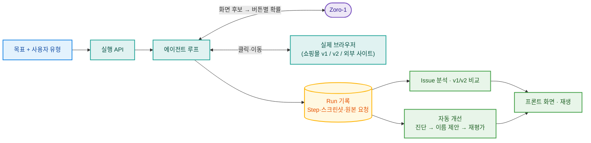
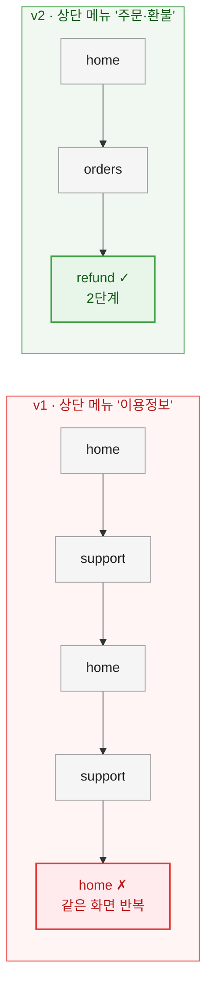
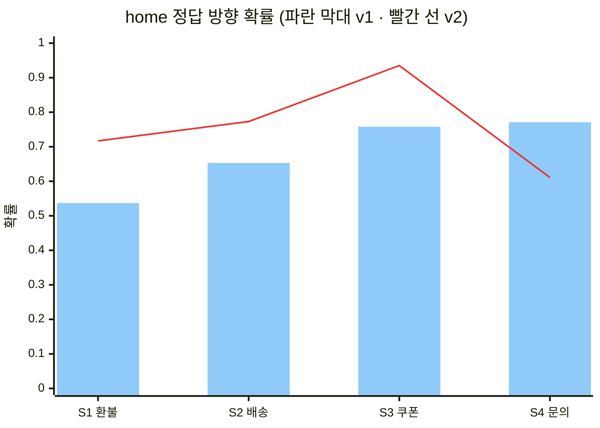
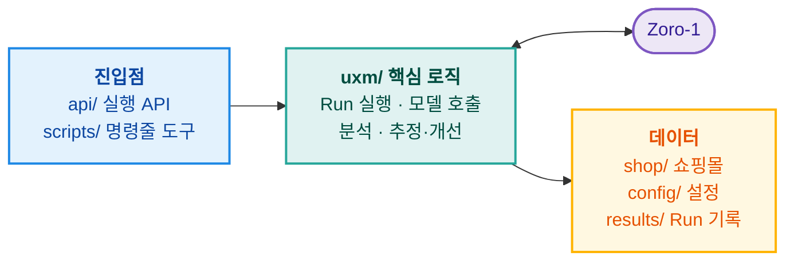
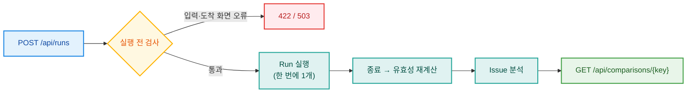
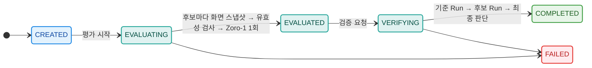
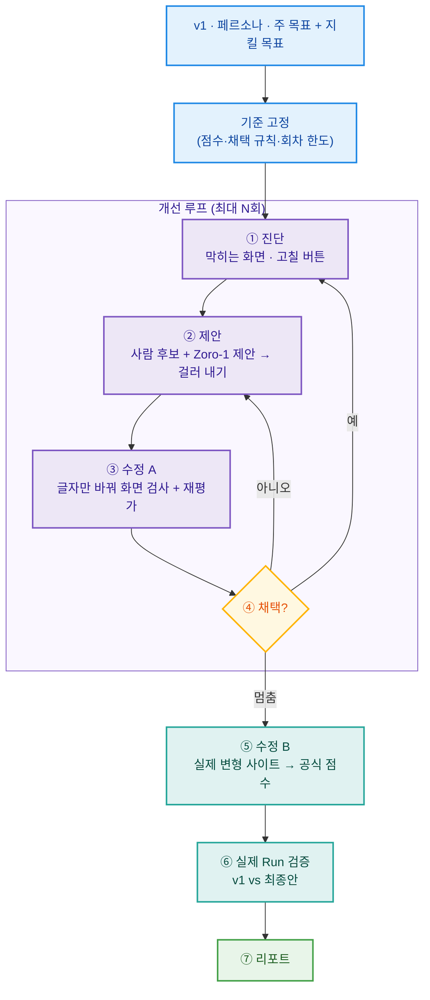
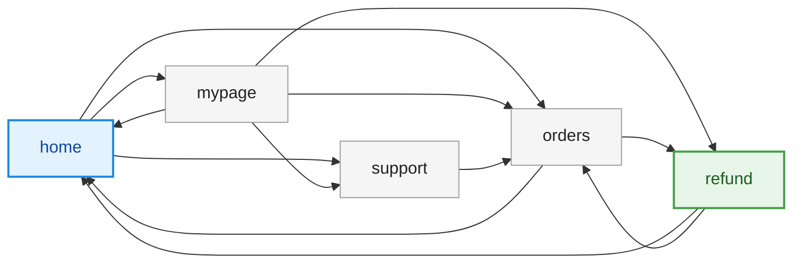

# UX MIRROR — 백엔드

> **Zoro-1이 사용자 대신 사이트를 탐색하고, 사용자가 막히는 화면과 버튼을 찾는다.**
> 사람 사용성 테스트 전에 확인할 화면과 버튼 이름 후보를 정리한다.



## 특징

- **막히는 버튼 탐지 → 이름 수정 제안** ([자동 개선 에이전트](#자동-개선-에이전트))
- **다른 목표 점수도 확인.** 다른 목표가 2%p 넘게 내려가면 탈락
- **사이트 수정 없이 실행.** 도착 판정 = 주소 + 화면 글자 ([외부 사이트 시나리오](#외부-사이트-시나리오))
- **브라우저 실행 없이 도달 확률 추정** ([목표 도달 확률 엔진](#목표-도달-확률-엔진))
- **결과는 사람 사용성 테스트에 올릴 후보**

## Zoro-1의 역할

화면마다 "다음에 누를 버튼"을 묻고, 버튼별 확률을 받는다.

| 쓰임 | 하는 일 | 코드 |
|---|---|---|
| 빠른 진단 | 선택이 헷갈리는 화면, 목표로 못 가는 화면 찾기 | `uxm/screen_request.py`, `uxm/metrics.py`, `uxm/reach.py` |
| 라우팅 | 고른 버튼을 눌러 목표까지 이동 | `uxm/agent.py`, `uxm/browser.py` |
| 검증 | 바꾼 이름 재평가, 최종안 브라우저 재실행 | `api/optimizer.py`, `uxm/label_edit.py`, `api/improvement.py` |

- 실행 조건: 행사 GPU(L40S, bf16), temperature 1.52, prompt v2
- 도착 판정은 모델 대신 주소 + 화면 글자로 (모델 YES/NO 오답 때문, [결정 사항](#결정-사항))

## 결과: v1 vs v2

쇼핑몰 v1·v2, 같은 목표·같은 사용자 유형. Run 8개 모두 `VALID`. 기록: [run-logs/](run-logs/README.md)



| 목표 | 결과 v1 → v2 | 이동 수 v1 → v2 | 되돌아가기 v1 → v2 | 실행 시간 v1 → v2 | home 정답 방향 확률 v1 → v2 |
|---|---|---|---|---|---|
| S1 환불 (최단 2) | **실패 → 성공** | 4 → **2** | 2 → **0** | 7.3초 → **3.7초** | 0.537 → **0.717** (+18.0%p) |
| S2 배송 조회 (최단 1) | 성공 → 성공 | 1 → 1 | 0 → 0 | 2.9초 → 2.1초 | 0.653 → **0.773** (+12.0%p) |
| S3 쿠폰 (최단 1) | 성공 → 성공 | 1 → 1 | 0 → 0 | 2.2초 → 2.5초 | 0.758 → **0.935** (+17.7%p) |
| S4 문의 (최단 1) | 성공 → 성공 | 1 → 1 | 0 → 0 | 3.4초 → 2.2초 | 0.771 → 0.611 (**−16.0%p**) |



- home 정답 방향 확률 = 첫 화면에서 목표 쪽 버튼들의 확률 합
- S1: 바뀐 메뉴 확률 0.205 → 0.596. v1은 `고객센터`(0.341)를 골라 같은 화면 반복
- S4: v2에서 −16.0%p. 한 목표에 맞춘 이름이 다른 목표엔 불리할 수 있음

## 빠른 실행

```bash
python shop/moro-before/server.py --port 8001     # v1
python shop/moro-after/server.py --port 8002      # v2
python -m uvicorn api.main:app --port 8000        # API (.env에 행사 GPU 설정)
curl localhost:8000/api/health                    # 모델·브라우저·에이전트 READY 확인
```

프론트(UX-Mirror-FE)에서 목표·사용자 유형 선택 → v1·v2 Run → 경로·Issue·비교 표시. 저장된 Run은 재생 가능.

## 실패 처리

| 상황 | 동작 |
|---|---|
| 브라우저·페이지 로드 실패 | 그 Run은 `ERROR`·`INVALID`로 끝나고 비교에서 제외, 서버는 다음 요청을 받음 |
| 같은 화면 반복·단계 초과 | 멈추고 Issue로 기록 |
| 모델 시간 초과 | Run: `TIMEOUT`(`VALID`)으로 종료. Optimizer: 그 후보만 `MODEL_TIMEOUT`, 늦은 호출이 끝날 때까지 새 실행 차단 |
| 서버 재시작 | 진행 중이던 Run은 `INVALID`(`BROWSER_CRASH`), Optimization은 전체 `FAILED`(`OPTIMIZATION_INTERRUPTED`). v1·v2 실행 사이에는 재시작하지 않는다 |
| 동시 실행 요청 | 한 번에 1개 (`409`) |
| 잘못된 입력·없는 도착 화면 | 실행 전 확인 후 거절 (`422`/`503`) |
| 외부 사이트 위험 버튼 | 주문·삭제·로그아웃·장바구니 변경 제외, 등록 화면만 이동 |
| 실험 정보 누출 | 모델 입력에 버전·정답 정보가 있으면 요청 차단 |
| 계산할 수 없는 값 | 0 대신 `null` + 사유 |
| 공개 로그 비밀값 | 키·토큰·서버 주소가 있으면 내보내기 중단 |

테스트 898개 (`pytest -q tests`, 모델 없이 실행).

## 기능 지도

| 흐름 | 내용 |
|---|---|
| [단일 판단](#설치실행) | 브라우저 없이 화면 1개에서 Zoro-1 판단 확인 (A1~A10) |
| [버전 비교](#실행-api) | v1(8001)·v2(8002)에서 같은 목표로 Run 1쌍 → Issue 분석·비교 |
| [외부 사이트 시나리오](#외부-사이트-시나리오) | 등록한 외부 사이트(cafe24) 1곳에서 Run 1개 |
| [UX Optimizer](#ux-optimizer) | 사람이 만든 이름 후보 C1~C4 평가 → 선정 → 실제 Run 재검증 |
| [목표 도달 확률 엔진](#목표-도달-확률-엔진) | 실행 없이 사이트 지도 + 화면별 확률로 도달 확률 추정 |
| [자동 개선 에이전트](#자동-개선-에이전트) (진행 중) | v1 하나로 진단 → 이름 제안 → 수정 → 재평가 → 실제 Run 검증 |

## 구조



| 폴더 | 역할 | 주요 파일 |
|---|---|---|
| `uxm/` | 핵심 로직 (API 없이 동작) | 아래 표 |
| `api/` | 실행 API | `main.py`, `runner.py`, `optimizer.py`, `improvement.py`, `integrations.py`(모듈 연결) |
| `scripts/` | 명령줄 도구 | `build_shop.py`, `build_sitemap.py`, `estimate_reach.py`, `export_run_logs.py` |
| `shop/` | 테스트 쇼핑몰 | `moro-before`(v1), `moro-after`(v2), `moro-c1·c3·c4`(이름 변형). 생성 결과라 직접 수정 금지, 원본은 `stitch_moro_market/` |
| `config/` | 설정 | 목표·페르소나(`presets.json`), 사이트, 사이트 지도, Optimizer 후보 |
| `tests/` | 테스트 | 모델 없이 실행 |
| `vendor/trida-stack/` | 공식 코드 일부 (Apache-2.0) | 요청 인코딩·서버 |

`uxm/` 파일:

| 묶음 | 파일 | 하는 일 |
|---|---|---|
| Run 실행 | `agent.py` | 판단 → 클릭 → 도착 판정 → 저장 반복 |
| | `browser.py` | 브라우저 조작 |
| | `candidates.py` | 화면에서 클릭 후보 추출 |
| | `goal.py` | 도착 판정 (주소 + 화면 글자) |
| | `storage.py`, `status.py` | Run 저장, 종료 상태 |
| 모델 호출 | `backends.py`, `mock.py` | Zoro-1 서버 / 로컬 / 가짜 모델 |
| | `prompts.py`, `screen_request.py` | 요청 문구, 화면 → 요청 변환 |
| | `leak.py` | 모델 입력의 정답 정보 차단 |
| 분석 | `analysis.py`, `comparison.py`, `reference.py` | Issue 탐지, v1/v2 비교, 경로 기준 |
| | `metrics.py` | 엔트로피, Top-2 |
| 추정·개선 | `sitemap.py`, `reach.py` | 사이트 지도, 도달 확률 |
| | `optimizer_policy.py` | Optimizer 선정·판단 |
| | `improve_policy.py`, `label_edit.py` | 자동 개선: 이름 제안·채택, 글자 바꾸기·화면 검사 |
| 외부 사이트 | `site_scope.py`, `scenario_safety.py` | 탐색 범위, 위험 링크 차단 |

쇼핑몰 테스트 모드: 첫 주소에 `?testMode=nochange`(쿠폰함 눌러도 안 바뀜) | `deadend`(고객센터 배송 현황 숨김).

## 설치·실행

```powershell
py -3.11 -m venv .venv
.\.venv\Scripts\pip install torch --index-url https://download.pytorch.org/whl/cu126
.\.venv\Scripts\pip install numpy pillow -r requirements.txt
copy .env.example .env

.\.venv\Scripts\python -m pytest -q tests          # 오프라인 테스트
.\.venv\Scripts\python scripts\run_a.py --dry-run   # 단일 판단 요청 확인
.\.venv\Scripts\python scripts\run_a.py A2 A3       # 일부만 실행 (생략하면 A1~A10)
```

## 서버 배포 (EC2)

실행 API·브라우저·쇼핑몰 C0~C4를 서버 한 대에 올리고 행사 GPU와 연결하는 방법은 [`deploy/README.md`](deploy/README.md) (`./deploy/setup.sh`, #108).

## 실행 API

행사 Before/After 실행과 결과 보존 절차: [최종 Run 비교·증거 보존 절차](docs/final-run-evaluation.md)



| Method | 주소 | 내용 |
|---|---|---|
| GET | `/api/presets` | 목표·페르소나 선택지 |
| POST | `/api/runs` | `{experimentKey, variant, goalId \| goal+verification, personaId \| persona, maxSteps?, startPath?}` → `201` |
| GET | `/api/runs`, `/api/runs/{runId}` | 목록 / 상태·요약 |
| GET | `/api/runs/{runId}/steps`, `/issues` | Step, UX 검토 후보 |
| GET | `/api/runs/{runId}/screenshots/{stepId}?kind=original\|overlay`, `/screenshots/goal` | 스크린샷, 도착 화면 |
| GET | `/api/comparisons/{experimentKey}` | v1/v2 비교 (두 Run 모두 `VALID`·분석 완료일 때) |
| GET | `/api/health` | 모델·브라우저·에이전트 준비 상태 |

<details>
<summary>세부 규칙</summary>

- 동시에 1개만 실행(`409 RUN_ALREADY_ACTIVE`). 같은 `experimentKey`+`variant`에 VALID·진행 중 Run이 있으면 `409 EXPERIMENT_RUN_EXISTS`. INVALID Run만 다시 실행할 수 있고 원본의 `replacementRunId`에 연결된다.
- 루프나 브라우저 모듈이 없으면 `POST /api/runs`는 `503`.
- Issue 분석은 Run이 끝날 때 한 번 돌고 `issues.json`을 쓴다. 분석 전이면 비교는 `409 COMPARISON_NOT_READY`, 분석 실패면 `500 ANALYSIS_ERROR`. 나중에 분석: `python scripts/analyze_runs.py --all`.
- 목표는 `goalId` 또는 `goal` + `verification{path, text, exact?, scope?}`, 사용자 유형은 `personaId` 또는 `persona`. 직접 입력 문장이 비었거나 200자 초과·누출 금지 문자열이면 `422`.
- 직접 입력한 목표는 사이트 지도 기준(`referencePathConfig.basis = SITE_MAP`)으로 경로 지표를 낸다. 지도를 못 쓰면 `null`, 시작 화면에서 길이 없으면 `422`.
- 같은 `experimentKey`의 두 Run은 목표·사용자 유형·`verification`이 같아야 한다.
- 실행 전 검사: 직접 입력한 성공 조건은 v1·v2에서 도착 화면을 열어 확인한다. 없는 화면·다른 화면·글자 없음은 `422`, 10초 안에 못 열면 `503 BROWSER_ERROR`.
- preset 목표마다 시작 화면이 정해져 있다(`refund` = `/shop/home`). 다르면 `422`.
- `validity`는 루프가 넘긴 값을 쓰지 않고 종료 사유로 항상 다시 정한다. `PAGE_LOAD_FAILED`는 `ERROR` + `INVALID`.

</details>

## 외부 사이트 시나리오

등록한 외부 사이트 1곳에서 사용자 목표로 Run 1개를 돌린다. 사이트 설정은 `config/sites/<siteId>.json`, 탐색 범위는 `uxm/site_scope.py`.

| Method | Path | 설명 |
|---|---|---|
| GET | `/api/sites` | 사이트 목록: 화면(`pages`)·도착 가능 여부·공개 주소(`siteUrl`, `allowedHosts`)·지도 정보 |
| POST | `/api/runs` + `siteId` | 시나리오 Run |

<details>
<summary>세부 규칙</summary>

- `siteId`가 없으면 기존 MORO MARKET 버전 비교 Run.
- `variant=before`만, 목표는 직접 입력만. 시작·도착 화면은 등록된 화면 경로와 정확히 같아야 한다(다르면 `422`). 시작 화면을 생략하면 `startPage`.
- 사이트 주소는 Run에 넣지 않는다. `siteUrl`은 공개 주소일 때만 내려 주고(사설망·내부용 이름이면 `null`), 실행은 `siteId`로만 한다.
- 지도상 시작 화면에서 갈 수 없는 도착 화면은 `422`. 고를 수 없는 이유는 `goalUnavailableReason`(`START_PAGE` / `NO_GOAL_TEXT` / `UNREACHABLE_ON_SITE_MAP`). cafe24는 `qna`·`guide`·`company`가 닿지 않는 화면이다.
- 같은 `experimentKey`에 버전 비교 Run과 시나리오 Run을 섞을 수 없고, 비교 API는 시나리오 Run을 뺀다(`404`).

</details>

## UX Optimizer

사람이 만든 메뉴 이름 후보(C1~C4)를 Zoro-1로 평가 → 후보 선정 → 실제 브라우저 재검증 → 최종 판단.



행사 GPU 실행 결과 (환불 목표, 같은 조건으로 2회 실행). 기록: `results/optimizations/opt_20261119151216_78dd/`(표), `opt_20261119153742_9a81/`(2회차). 저장소에는 포함하지 않음.

| 후보 | 이름 | 사이트 | 대상 메뉴 확률 | 정답 경로 확률 | 결과 |
|---|---|---|---|---|---|
| C0 | 이용정보 | `moro-before` 8001 | 0.0778 | 0.9194 | 기준 |
| C1 | 주문·배송 | `moro-c1` 8003 | 0.3723 | 0.8969 (−2.25%p) | 제외 (경로 확률 −2%p 초과) |
| C2 | 주문·환불 | `moro-after` 8002 | **0.7252** (+64.74%p) | **0.9680** (+4.86%p) | **추천·검증 1위** |
| C3 | 주문·반품 | `moro-c3` 8004 | 0.6653 | 0.9499 (+3.05%p) | 2위 |
| C4 | 주문 관리 | `moro-c4` 8005 | 0.5829 | 0.9384 (+1.90%p) | 3위 |

- 실제 브라우저 재검증: C0 3단계 → C2 2단계 (이동 비용 −1), 최종 판단 `IMPROVEMENT_OBSERVED`.
- 두 번째 실행도 선정·제외·최종 판단이 같았고, 확률 차이는 최대 1.47%p (C2 대상 메뉴 0.7252 / 0.7105).

| Method | Path | 설명 |
|---|---|---|
| POST | `/api/optimizations` | 후보 평가 시작 → `202` |
| GET | `/api/optimizations/{id}` | 상태·진행·후보별 평가·선정·검증 Run·최종 판단 |
| POST | `/api/optimizations/{id}/verify` | 기준(C0)과 선정 후보를 차례로 실제 Run |
| GET | `/api/optimizations/{id}/report` | 완료된 보고서 |

선정 규칙: 정답 경로 확률이 기준보다 2%p 넘게 떨어지면 제외 → 남은 후보를 대상 메뉴 확률로 순위(1등과 1%p 이내를 한 그룹으로 묶어 의미 명확성 → 이름 길이 → 순서로 정렬, 남은 후보도 같은 방식으로 반복) → 대상 메뉴 확률이 기준보다 +5%p 이상이면 추천.

<details>
<summary>세부 규칙</summary>

- 후보·대상 메뉴·정책 버전은 `config/optimization.json`, 사이트는 `config/site_instances.json`(`baseUrl`은 응답·모델 요청에 넣지 않음). 생성 때 모델·목표·사이트 조건을 `frozenConditions`에 동결한다.
- 기준(C0)이 설정과 다르면 모델을 부르지 않고 `FAILED`(`BASELINE_INVALID`). 후보는 C0 대비 후보 수·순서·제목·목적지·영역·다른 이름·bbox ±2px·누출을 검사한다(`scripts/check_site_instances.py`로 모델 없이 점검).
- 결과: `targetOptionProbability`, `goalPathProbability`, `probabilities`(semanticKey 기준), 원본 요청·응답. 계산할 수 없는 지표는 `null` + `metricNullReasons`.
- 모델 시간 초과는 그 후보만 `MODEL_TIMEOUT`. 늦은 호출이 끝날 때까지 다른 실행을 막는다(`/api/health`의 `activeOptimization`).
- 검증 Run은 기존 Runner로 만들고(`experimentKey = optimizationId`, 기준 before / 후보 after), 만들기 전에 화면을 다시 찍어 평가 때와 같은지 확인한다(다르면 `SITE_INSTANCE_CHANGED`). 결과는 `variant`가 아니라 `optimizationContext.siteInstanceId`·`label`로 본다.
- 실패 코드(`error.code`): `BASELINE_INVALID`, `BASELINE_NOT_EVALUATED`, `MODEL_TIMEOUT`, `SITE_INSTANCE_CHANGED`, `SITE_RECHECK_FAILED`, `RUN_TIMEOUT`, `OPTIMIZATION_INTERRUPTED`(서버 재시작), `OPTIMIZATION_FAILED`.
- API 오류: `404 OPTIMIZATION_NOT_FOUND`, `409 OPTIMIZATION_NOT_READY`·`OPTIMIZATION_ALREADY_PROCESSED`·`RUN_ALREADY_ACTIVE`, `422 INVALID_SITE_INSTANCE`·`EXPERIMENT_CONDITION_MISMATCH`, `503 MODEL_UNAVAILABLE`·`OPTIMIZER_POLICY_UNAVAILABLE`(정책 모듈 없음).
- 선정 결과: `selection.excludedCandidates`(`candidateId`, `reasonCodes`), `selectionReasonCode`. 검증 판단: `verification.finalDecision`·`reasonCode`·`navigationCostDelta`. 이유 코드·근거 형식은 FE 연동 때 함께 확인한다.
- 동률 순위 `semanticClarityRank`(C2 1, C3 2, C4 3, C1 4, 작을수록 우선)는 `config/optimization.json`에 고정. 기준과 `goalPathBasis`가 다른 후보는 제외.
- 늦은 모델 호출이 남아 있으면 `/api/health`의 `activeOptimization.status`가 `MODEL_CALL_PENDING`.
- 저장: `results/optimizations/<optimizationId>/`.

</details>

## 자동 개선 에이전트

입력: 사이트 v1 + 페르소나 + 목표. 출력: 다른 목표 점수를 2%p 넘게 낮추지 않는 새 버튼 이름. (v1·v2 비교와 별도 실험)



| 1단계 범위 | |
|---|---|
| 사이트·목표 | MORO MARKET v1, 주 목표 S1 환불, 지킬 목표 S2 배송·S3 쿠폰·S4 문의 |
| 고칠 버튼 | 상단 메뉴 "이용정보" 자리 하나 (변형 사이트 생성기가 이 버튼만 바꿀 수 있음) |
| 점수 | 최단 이동 수 안 도달 확률 `reachWithinShortestProbability` |
| 채택 | 주 목표: 직전 채택안 대비 +5%p 이상 · 지킬 목표: **처음 v1 대비** −2%p 이내 · 1%p 이내는 동률 |
| 새 이름 | 1~6자 (84px 칸에 14px 한글은 7자까지 들어감, 실측) |
| A / B | A(글자만 바꾸기)는 후보 걸러 내기용, 발표 수치·실제 Run은 B(실제 변형 사이트)만 |

| 단계 | 함수 | 위치 | 상태 |
|---|---|---|---|
| 진단 재료 | `reach.estimate(...)["pageVisitProbability"]` | `uxm/reach.py` | 완료 |
| ① 진단 | `diagnose(...)` | 루프 | 진행 중 |
| ② 제안·걸러 내기 | `build_prompt`, `filter_labels` | `uxm/improve_policy.py` | 완료 ([연동 설명](docs/improve-policy-integration.md)) |
| ③ 수정 A·화면 검사 | `apply_label`, `check_layout` | `uxm/label_edit.py` | 완료 |
| ④ 채택 | `choose` | `uxm/improve_policy.py` | 완료 |
| 루프·저장·리포트 | `scripts/improve.py` → `results/improvements/<id>/` | 루프 | 진행 중 |
| ⑥ 실제 Run 검증 | `run_verification` | `api/improvement.py` | 완료 |

<details>
<summary>수정 A·화면 검사 사용법</summary>

```python
from uxm.label_edit import apply_label, check_layout, EDITABLE_KEY
extract = lambda p: (apply_label(p, EDITABLE_KEY, label), base_extract(p))[1]   # collect_page_probabilities(extract=...)
result = check_layout(baseline, page, EDITABLE_KEY, label)                      # {valid, reasons}
```

- `apply_label`: 상단 메뉴 이용정보 링크 글자만 바꾼다. 화면을 이동하면 원래대로 돌아오므로 화면을 열 때마다 다시 부른다. 바꿀 수 없으면 `ValueError`(루프는 `LABEL_NOT_APPLIED`).
- `check_layout`: `baseline`은 v1 home 스냅샷(`snapshot_from_extracted(extract(page), "/shop/home", VIEWPORT, "candidate-v2")`). 창 크기가 다르면 `VIEWPORT_MISMATCH`만, 그 외에는 Optimizer와 같은 검사(후보·위치 ±2px·새 이름 적용 여부) + 글자 넘침 `LABEL_OVERFLOW`. B 화면에도 그대로 쓴다.
- C1~C4 이름으로 A와 B 결과가 같음을 테스트로 확인했다.

</details>

<details>
<summary>최종안 검증 Run 사용법</summary>

```python
from api.improvement import run_verification
runs = run_verification(frozen, "http://127.0.0.1:8010", "주문·조회", ["refund", s4_goal])
```

- 목표마다 v1(`site-c0`, before) → 최종안(after) Run 1쌍. 같은 목표의 두 Run은 같은 `experimentKey`(`<improvementId>-<goalId>`)라 기존 비교·재생 화면을 그대로 쓴다.
- `frozen`: `improvementId`, `personaId`, `persona`, `startPath`, `viewport`, `limits.maxSteps`, `modelMetadata`. `goals`: preset goalId 또는 `{goalId, goal, verification, referencePathConfig}`.
- 반환: `[{runId, goalId, experimentKey, variant, executionRole, label, status, validity}]`. Run에는 `improvementContext`만 남고 최종안 주소는 남지 않는다.
- 입력 오류는 Run을 만들기 전에 `ValueError`, 제한 시간(600초) 초과는 `TimeoutError`(끝난 Run 목록은 예외의 `runs`). 실행 중에는 API로 Run을 만들지 않는다.

</details>

## 목표 도달 확률 엔진

실행 없이 "이 목표에 닿을 확률"을 본다. 사이트 지도 간선 + 화면마다 Zoro-1이 준 후보 확률(화면당 1번) → 화면 사이 이동 확률 → 단계별 도달 확률 (`uxm/reach.py`).

```
python scripts/estimate_reach.py                                   # v1/v2, 환불 목표
python scripts/estimate_reach.py --goal-page orders --persona "70대, 인터넷 쇼핑이 서툰 사용자"
python scripts/estimate_reach.py --url C1=http://127.0.0.1:8003 --url C2=http://127.0.0.1:8002
python scripts/estimate_reach.py --site cafe24-ons                 # 외부 사이트
```

| 값 | 뜻 |
|---|---|
| `reachWithinShortestProbability` | 지도상 최단 이동 수 안에 닿을 확률 (비교·채택에 쓰는 값) |
| `reachProbability` | `maxSteps` 안에 닿을 확률 (넉넉하면 거의 1이라 참고만) |
| `expectedStepsGivenReach`, `mostLikelyPath` | 닿을 때 기대 단계, 가장 가능성 높은 경로 |
| `pageVisitProbability` | 도착 전에 그 화면에서 한 번 이상 고르게 될 확률 (자동 개선 진단용) |
| `lostProbability`, `unfinishedProbability` | 지도 밖으로 가는 확률, 못 닿은 확률 |

- **구조 기준 추정치**다. 되돌아가기·재방문 제한이 없어 실제 Run과 다를 수 있다.
- 실제 화면 후보와 지도가 다르면 `MAP_MISMATCH`(비교 불가), 확률이 빠진 화면이 있으면 `INCOMPLETE`(개선 판단에 쓰지 않음). 결과는 `results/reach/`.
- 계산할 수 없는 값은 `null`이고 사유는 `nullReasons`(`MAX_STEPS_BELOW_SHORTEST`: `--max-steps`가 최단 이동 수보다 작음, `GOAL_UNREACHABLE_ON_MAP`: 지도상 길 없음).

## 사이트 지도

후보 규칙으로 뽑은 링크만으로 "화면 → 갈 수 있는 화면" 지도를 만든다. 쇼핑몰 링크 전체를 쓰면 모든 화면이 서로 이어져 최단 거리가 전부 1이 되기 때문이다.



```
python scripts/build_sitemap.py --check-runs   # 생성 + 저장된 Run 후보와 대조
python scripts/build_sitemap.py --dry-run      # 파일을 쓰지 않고 결과만
```

<details>
<summary>세부 규칙</summary>

- 화면 5개를 v1·v2 각각 새 브라우저(1440×900)로 열어 후보를 뽑는다. 간선 = `{fromPageKey, semanticKey, to}`.
- 검증(하나라도 실패하면 파일을 만들지 않음): 화면 누락, v1·v2 간선 일치, home에서 모든 화면 도달, preset 허용 경로 대조. 저장된 LIVE Run Step 76개와 대조해 불일치 0.
- `siteMapHash`: `pages`의 `{path, edges}`만 정렬·중복 제거해 SHA-256.
- Run에 `referencePathConfig.basis = SITE_MAP`이면 복사된 거리로 경로 지표를 낸다: `extraSteps`(최단보다 더 간 수), `detourMoveCount`(거리가 줄지 않은 이동), Step `goalPathProbability`(거리를 줄이는 후보 확률 합).
- 다른 사이트는 `config/sites/`에 설정을 만들고 `--site 파일 --url 이름=주소`로 실행한다.

</details>

## 제출용 실행 로그

`results/runs/`는 Git에서 빠져 있으므로 고른 Run을 `run-logs/`로 복사한다.

```
python scripts/export_run_logs.py <runId1> <runId2> <runId3>
python scripts/export_run_logs.py --results-dir <GPU 결과> --env <GPU .env> <runId> ...
```

- 공개되면 안 되는 값(인증 정보, `.env`의 키·서버 주소, IP·포트 주소, 로컬 경로)을 모두 찾아 보여 주고, 하나라도 있으면 아무것도 쓰지 않는다. 확인한 값은 `--allow`로 건너뛴다.
- 출력 폴더가 이미 있으면 멈추고, `--force`는 이 스크립트가 만든 폴더만 다시 만든다. 중간에 실패하면 이전 제출본을 되돌린다.
- `run-logs/README.md`에 Run별 목표·결과·경로·Issue·모델을 정리한다. 행사 Run이 아니거나 무효·분석 미완료면 "확인 필요"로 표시한다.

## 프론트엔드 연동 테스트

임시 MOCK Run으로 FastAPI와 프론트(Vite)를 띄워 확인한다. 모델은 호출하지 않는다. 프론트에서 `npm ci`, 백엔드에서 `python -m playwright install chromium`을 먼저 한다.

```bash
UXM_FRONTEND_PATH="/path/to/UX-Mirror-FE" .venv/bin/python -m pytest -q tests/test_frontend_live_api.py
```

변수가 없으면 건너뛴다. GitHub Actions `프론트 실제 API 연동` 워크플로가 PR마다 실행한다(기본 프론트 커밋 `cbf79e469d31c6b9173e155491927bbf13bb7542`, 수동 실행 시 ref 지정 가능).

## 모델 설정 (.env)

| 설정 | 용도 |
|---|---|
| `ZORO_BACKEND=http`, `ZORO_BASE_URL=...`, `ZORO_ENDPOINT_ID=brev-l40s-bf16` | **행사 GPU 서버 (L40S, bf16). 발표 수치는 이것만.** 주소가 바뀌면 `ZORO_BASE_URL`만 바꾸고, 주소는 커밋하지 않는다 |
| `ZORO_BACKEND=local`, `ZORO_DEVICE=cuda-4bit` | 개발용 (GTX 1660 6GB, nf4). 확률이 원본과 다를 수 있어 형식 확인용 |
| `ZORO_BACKEND=local`, `ZORO_DEVICE=cpu` | 원본 bf16 확인 (RAM 9GB+, 느림) |

`ZORO_TEMPERATURE=1.52`(모델 카드 보정값)를 요청마다 보낸다. v1·v2 동일 필수. 서버: `python vendor/trida-stack/inference/zoro-1/serve_decide.py <Zoro-1 경로> --port 30001` (SGLang ≥0.5.22, Linux).

## 결정 사항

### 도착 판정은 "주소 + 보이는 글자" (`DOM_ONLY`)

모델 YES/NO 판정이 오탐을 냈다 (cuda-4bit 측정).

| 질문 문구 | refund (기대 YES) | orders (기대 NO) |
|---|---|---|
| v1 "현재 화면에서 목표를 바로 수행할 수 있습니까?" | 0.566 통과 | 0.672 **오탐** |
| v2 "현재 화면이 찾던 바로 그 화면입니까?" | 0.832 통과 | 0.700 **오탐** |

- orders 화면의 `환불 신청` 버튼 글자가 목표 문구와 겹쳐서 생긴 오탐으로 추정.
- 그래서 성공은 테스트용 표시 없이 "주소 + 화면에 보이는 글자"로 판정한다(예: `/shop/refund` + `환불 / 반품 신청`). 사이트를 고치지 않아도 돼 실제 사이트에도 쓸 수 있다. 주소만으로는 성공 처리하지 않는다. 구현 `uxm/goal.py`, 설정 `GOAL_JUDGMENT_MODE`.

### 클릭 후보 규칙

1. 다른 페이지로 이동하는 링크만
2. 첫 화면(1440×900, 스크롤 없음)에 보이는 것만, 이름도 보이는 글자만
3. 현재 페이지로 가는 링크 제외
4. 위험 동작 제외 (회원 탈퇴, 로그아웃, 접수하기 등)
5. **상단 공통 메뉴는 홈에서만 후보** — orders에서 상단 메뉴가 후보에 있으면 `환불 신청하기`를 0.223(bf16)만 고르고 마이페이지로 샌다. 빼면 0.928. 허용된 튜닝으로는 최고 0.25였다.

구현 `uxm/candidates.py`, 눈으로 확인 `scripts/show_candidates.py`.

## 모델 API 메모

- `POST /v1/decide` body: `{"request": {"state": ..., "questions": {...}}, "reasoning": false, "temperature": 1.52}`
- `choice` 응답: `{"type","choice","confidence","probabilities"}` — `confidence`는 최고 확률이 아니라 `(max-1/k)/(1-1/k)`
- 예/아니요는 **`noul`** 타입, 응답은 `{"noul": P(yes)}`
- 요청 최상위 키는 `state, questions, image, min_image_pixels, max_image_pixels`만 허용
